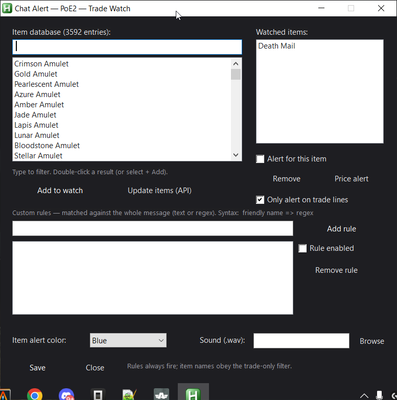

<div align="center">

# Chat Alert — Path of Exile 2

Real-time **chat**, **trade** and **price** alerts for Path of Exile 2, read straight from the game's own chat log.

-6594B9?logo=autohotkey&logoColor=white)


[Quick start](#quick-start) · [Features](#features) · [Screenshots](#screenshots) · [Troubleshooting](#troubleshooting)

</div>

---

**Chat Alert** tails the chat log that Path of Exile 2 writes to disk and pops an on-screen banner the moment something
you care about appears: a guildmate asking for leech, a player selling the unique you are hunting, or an item dropping
below the price you are willing to pay.

It never touches the game process. It only reads a text file — no injection, no memory access, no FPS impact.

| | |
|---|---|
| **Watch anything** | Word lists with per-word case-sensitivity, whole-word matching and priority |
| **Trade watch** | Built-in database of 3,592 items, watchlist, price range / bulk filters, custom regex rules |
| **Price tracking** | Automatic price extraction, per-item history, "dropped below X divine" alerts |
| **Never miss a deal** | Push alerts to Discord or ntfy (phone notifications) |
| **Stay organised** | Profiles, channel colours and sounds, searchable history, CSV export, statistics |
| **Built for playing** | Global hotkeys, mute, compact always-on-top overlay panel |

---

## Table of contents

- [Quick start](#quick-start)
- [How it works](#how-it-works)
- [Features](#features)
  - [1. Word alerts](#1-word-alerts)
  - [2. Profiles](#2-profiles)
  - [3. Channels, categories and sounds](#3-channels-categories-and-sounds)
  - [4. Trade Watch](#4-trade-watch)
  - [5. Price tracking and drop alerts](#5-price-tracking-and-drop-alerts)
  - [6. External notifications](#6-external-notifications)
  - [7. History and message panel](#7-history-and-message-panel)
  - [8. Overlay panel](#8-overlay-panel)
  - [9. Statistics](#9-statistics)
  - [10. Global hotkeys](#10-global-hotkeys)
  - [11. Settings reference](#11-settings-reference)
- [Screenshots](#screenshots)
- [Files and data](#files-and-data)
- [Troubleshooting](#troubleshooting)
- [FAQ](#faq)
- [Safety and disclaimer](#safety-and-disclaimer)

---

## Quick start

1. **Install AutoHotkey v1.1 (64-bit)** — [autohotkey.com](https://www.autohotkey.com/download/ahk-v1-1.zip). AutoHotkey **v2 is not supported**.
2. **Download** this repository (green *Code* button → *Download ZIP*) and extract it anywhere.
3. **Run** `PoE2-Chat-Alert.ahk` (double-click).
4. In the main window press **Choose log...** (or open **Settings**) and point it to your game log:
   ```
   <Steam or game folder>\Path of Exile 2\logs\Client.txt
   ```
5. Type a word in the **Words** box, press **Add** (e.g. `leech`), then press **Start** — or just hit `Ctrl+Alt+S`.

That's it. The status bar shows `listening to chat (every 500 ms)` when it is working.

> The item database (`items.txt`) ships with the app. If it is missing or outdated, open **Trade watch → Update items (API)**.

---

## How it works

Path of Exile 2 writes every chat message to a plain-text log on your disk:

```
... [INFO Client 1234] $SomePlayer: WTS Perfect Strike 5 divine
```

Chat Alert reads **only the new lines** of that file every **500 ms**, and runs each one through:

1. your **word lists** (per profile),
2. your **item watchlist** (including custom text/regex rules),
3. **price extraction** (divine / exalted / chaos / alchemy).

When something matches, it shows a banner, plays a sound, adds a row to history, and — if enabled — sends an external
notification. Everything is logged locally to `PoE2-Chat-Alert-matches.txt`.

Because the game only ever **writes** the log and Chat Alert only **reads** it, there is no interaction with the game
client at all. Chat Alert does not need the game to be in focus and keeps working in windowed, borderless or fullscreen.

---

## Features

### 1. Word alerts

The core of the app. Add any word or phrase and get an alert whenever it appears in chat.

- **Add / Delete** words from the active profile.
- **Per-word options** (*Options...* button or the `Cs` / `WW` / `Prio` columns):

  | Option | Meaning |
  |---|---|
  | **Cs** | Case-sensitive matching (`Leech` will not match `leech`) |
  | **WW** | Whole word only (`leech` will not match `leeching`) |
  | **Prio** | `Normal`, `High` or `Urgent` — higher priority means a louder sound and a longer banner |

- **Cooldown** prevents the same alert from spamming you repeatedly (default: 10 seconds).
- Matching ignores your own messages and system lines.

### 2. Profiles

Different characters, different leagues, different goals — keep separate word lists.

- Switch instantly from the **Profile** dropdown.
- **New** creates a profile, **Delete** removes it.
- **Export** / **Import** a profile to and from a `.ini` file, so you can share or back up your lists.

### 3. Channels, categories and sounds

Every message is classified by the channel it came from, and each channel has its own colour and sound.

| Channel | Prefix in log | Notes |
|---|---|---|
| Global | `#` | |
| Trade | `$` | Also drives price extraction and item alerts |
| Party | `%` | |
| Whisper | `@From` | Always at least *High* priority |
| Guild | `&` | |

Open **Categories** to:

- enable or disable each channel independently,
- pick the colour used on the banner and in history,
- pick a sound per category,
- preview the sound with **Test sound**.

If a category has no sound of its own, the global alarm sound from **Settings** is used.

### 4. Trade Watch

A dedicated window for everything trade-related (`Ctrl+Alt+W`, or the **Trade watch** button).

**Item database**

- Ships with **3,592 entries** (base types and uniques).
- Type to filter instantly; double-click a result (or select + **Add to watch**) to watch it.
- **Update items (API)** refreshes the database from the official Path of Exile 2 trade API.

**Watchlist**

- Every watched item is listed on the right. Tick **Alert for this item** to turn alerts on or off.
- **Remove** deletes an item from the watchlist.
- **Price alert** sets a per-item price threshold (see [section 5](#5-price-tracking-and-drop-alerts)).
- **Only alert on trade lines** (on by default) keeps item alerts limited to the Trade channel. Untick it to be
  alerted wherever the item is named.
- **Item alert color** and **Sound (.wav)** configure how item alerts look and sound.

**Custom rules**

- Add your own rules matched against the whole message, either as plain text or as a regular expression.
- Syntax: `friendly name => pattern`.
- **Rule enabled** toggles a rule without deleting it.

### 5. Price tracking and drop alerts

Every trade message is scanned for a price:

```
WTS Morior Invictus 45 div      ->  45 divine
Selling Perfect Strike — 2 ex   ->  2 exalted
```

Supported units: `divine`, `exalted`, `chaos`, `alchemy` (with common abbreviations such as `div`, `divs`, `ex`).

**On the banner** the price is shown on the right side of the alert, so you can judge an offer at a glance.

**Price history** — press **Prices** in the main window to see the recorded history per item, most recent last,
with timestamps. History is stored locally and keeps the last 50 prices per item.

**Drop alerts** — set a threshold for an item:

1. Open **Trade watch**.
2. Select the item in the watchlist.
3. Press **Price alert** and enter a price in divine (leave it empty to remove the threshold).
4. When a trade message lists that item **below** your threshold, you get an **urgent, red `DROP`** alert instead of
   a normal one.

### 6. External notifications

Send alerts to your phone or another device while you are away from the keyboard.

| Provider | What to paste |
|---|---|
| **Discord** | A channel webhook URL (`https://discord.com/api/webhooks/...`) |
| **ntfy** | A topic URL (`https://ntfy.sh/<your-topic>`) |

- Configure in **Settings → Notify (phone)**: choose the provider and paste the URL.
- **Test notify** sends a test message immediately, so you can verify the setup.
- Notifications fire on every banner alert and include the channel, player, word/item, price and the `DROP` marker.

### 7. History and message panel

Every match is added to the table: **Time · Channel · Player · Word · Message**.

- **Search** box filters by text; the dropdowns filter by channel and by player.
- **Click a row** to read the full message in the panel below — no more squinting at truncated chat lines.
- **Double-click** a row to copy the full line.
- **Right-click** a row for: *Copy line*, *Copy player*, *Whisper player*.
- Buttons: **Reply** (quick reply), **Copy**, **Whisper**, **Clear**.
- **Quick reply** box — type a canned reply and press **Reply** to build `/whisper <player> <text>`.
- Every copy action confirms itself with a short on-screen toast, so you always know it worked.
- History is **saved and restored** between sessions.
- **Export CSV** writes the full history (including the `Price` column) for spreadsheets or analysis.

### 8. Overlay panel

A compact, always-on-top list of recent alerts with a running counter.

- Toggle it with `Ctrl+Alt+O` or the overlay button.
- Useful on a second monitor, or on top of the game when you do not want the full window open.

### 9. Statistics

Press **Stats** for a quick dashboard:

- total matches, number of words with hits, top word, active profile,
- per-word match counts, sorted descending.

### 10. Global hotkeys

These work while the game has focus (unless the key is bound in-game):

| Hotkey | Action |
|---|---|
| `Ctrl+Alt+M` | Toggle mute |
| `Ctrl+Alt+S` | Start / stop watching |
| `Ctrl+Alt+W` | Open Trade Watch |
| `Ctrl+Alt+H` | Hide / show the main window |
| `Ctrl+Alt+O` | Toggle the overlay panel |

### 11. Settings reference

| Setting | Description |
|---|---|
| **Log file** | Path to `logs/Client.txt` of your PoE2 installation |
| **Alarm sound (.wav)** | Fallback sound used when a category has none |
| **Banner position** | `top`, `center` or `bottom` |
| **Banner width** | Banner width in pixels (default 380) |
| **Beeps** | Number of beeps played with the alert |
| **Cooldown (s)** | Minimum seconds between two alerts (default 10) |
| **Banner (s)** | How long the banner stays on screen (default 8) |
| **Start with Windows (login)** | Launch Chat Alert when you log in |
| **Start minimized in the tray** | Start hidden with a tray icon |
| **Notify (phone)** | `off`, `discord` or `ntfy` |
| **Trade filters** | `Min` / `Max` price, `Only bulk`, `Bulk min` — `0` disables a filter |

Settings are saved automatically to `PoE2-Chat-Alert.ini`.

---

## Screenshots

### Main window

Profiles, word list, searchable history and the full-message panel in a single dark window.


### In-game alert

A Trade alert rendered over the game: channel tag, word, player and message. Prices and a `DROP` marker appear here
when relevant.


### Trade Watch

Item database search, watchlist, per-item price alerts, custom rules, trade filters and item sound.



### Settings

Log path, alarm sound, banner behaviour, Windows startup, phone notifications and trade filters.


---

## Files and data

| File | Purpose | In git |
|---|---|---|
| `PoE2-Chat-Alert.ahk` | The application | yes |
| `items.txt` | Item database used by Trade Watch | yes |
| `README.md`, `screenshots/` | Documentation | yes |
| `PoE2-Chat-Alert.ini` | Your settings, profiles, watchlist and price history (created on first run) | no |
| `PoE2-Chat-Alert-matches.txt` | Local log of every match | no |
| `PoE2-Chat-Alert-<timestamp>.csv` | History exports created by *Export CSV* | no |

Everything is stored next to the script. Delete the `.ini` file to reset the app to defaults.

---

## Troubleshooting

**The status bar says "Log not found"**
Set the correct path in **Settings → Log file → Browse** (or **Choose log...** on the main window). The file must be
`...\Path of Exile 2\logs\Client.txt`. Make sure the game has been launched at least once so the log exists.

**No alerts appear**
Check, in order: the app is **Watching** (not *Stop*), the active profile contains your word, the relevant channel is
enabled in **Categories**, and the message is not within the cooldown window. Remember that only *new* lines are read —
messages already in the log before you start are not replayed.

**Trade Watch shows no items**
`items.txt` is missing or was not found. Press **Update items (API)** (needs internet).

**An item I watch never alerts**
Make sure **Alert for this item** is ticked. If **Only alert on trade lines** is ticked, the item is only matched in the
Trade channel. Item names are matched in English.

**Phone notifications do not arrive**
Press **Test notify**. For Discord, verify the webhook URL still exists in the channel settings. For ntfy, verify the
topic URL and that your phone is subscribed to the same topic. Check your firewall if the test hangs.

**"This script requires AutoHotkey v1.1" or a v2 error**
You have AutoHotkey v2 installed (or both, with v2 as default). Install **v1.1 64-bit** and make sure `AutoHotkey.exe`
v1.1 is the interpreter used for `.ahk` files, or run the script explicitly with the v1.1 executable.

**Windows SmartScreen warns about the file**
The script is plain text AutoHotkey — open it in Notepad to inspect it. If you trust the source, choose *More info →
Run anyway* (or unblock the ZIP before extracting).

**Hotkeys do not work**
Another application may own the same combination. Close it, or use the on-screen buttons instead.

---

## FAQ

**Can I be banned for using this?**
Chat Alert only **reads a text file** written by the game. It does not read memory, inject code, automate input or
interact with the client in any way. Still, use it at your own risk — see the disclaimer below.

**Does it work with the standalone client?**
Yes. Point it at that installation's `logs/Client.txt` in Settings.

**Does it work with a non-English client?**
The UI and item database are English, and item names are matched in English. Channel detection uses the `#`, `$`, `%`,
`@`, `&` prefixes, so it is largely language-independent; plain word matching works with any text.

**Can I run two copies?**
No — the script enforces a single instance. Use profiles for different setups.

**Where are my settings?**
In `PoE2-Chat-Alert.ini`, next to the script. Back it up to keep your profiles and watchlist.

**How do I update the item database?**
**Trade watch → Update items (API)**, or replace `items.txt` with a newer one.

---

## Safety and disclaimer

- Chat Alert is **read-only**: it reads `Client.txt` and never writes to it.
- No game files are modified, no memory is read, no input is sent to the game.
- All data stays on your machine. The only outbound traffic is what you explicitly enable:
  **Update items (API)** (trade API) and external notifications (your own Discord webhook or ntfy topic).
- Your settings file is git-ignored and never published.

This is a community tool and is **not affiliated with, endorsed by, or supported by Grinding Gear Games**.
Path of Exile 2 is a trademark of Grinding Gear Games. Use at your own risk.

---

## Contributing

Issues and pull requests are welcome. When reporting a bug, please include:

- what you expected and what happened,
- the relevant lines from `PoE2-Chat-Alert-matches.txt` (remove any personal data),
- your AutoHotkey version and Windows version.

If you add or change a feature, keep it dependency-free, AutoHotkey v1.1 compatible, and update this README.
