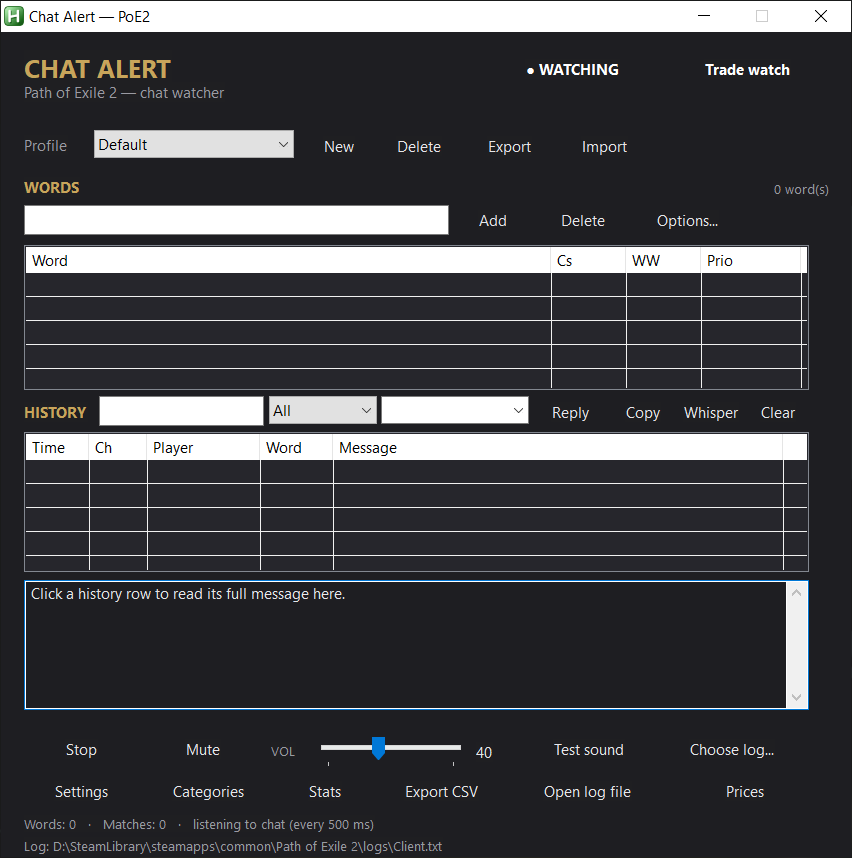
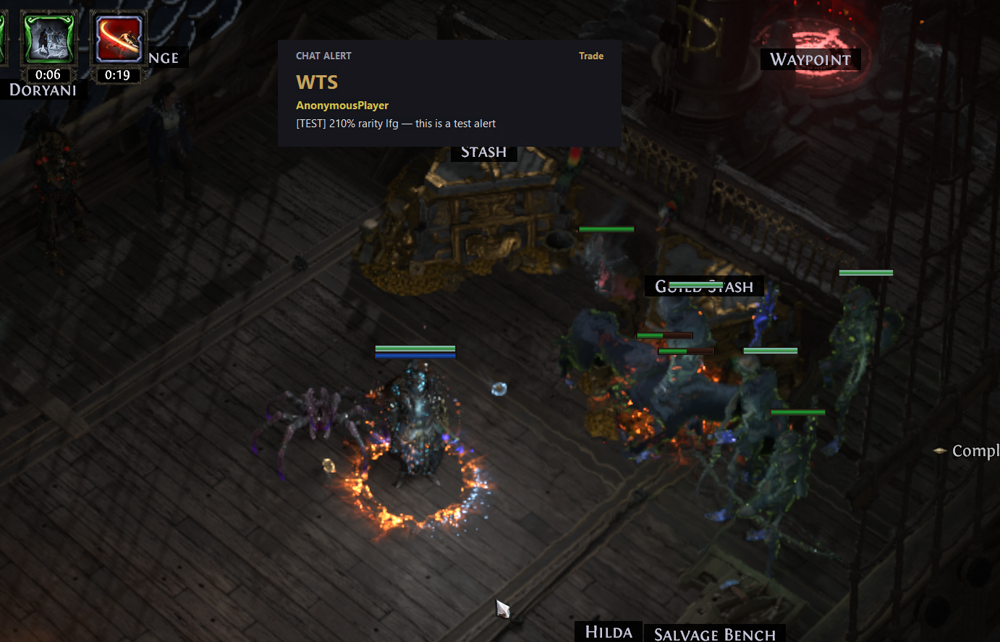
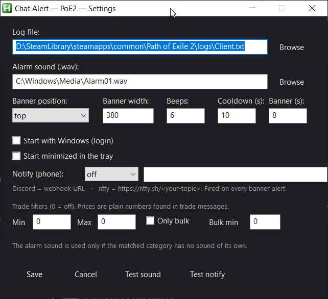

<div align="center">

# Chat Alert — Path of Exile 2

Real-time **chat alerts** for Path of Exile 2, read straight from the game's own chat log.

-6594B9?logo=autohotkey&logoColor=white)


[Quick start](#quick-start) · [Features](#features) · [Screenshots](#screenshots) · [Troubleshooting](#troubleshooting)

</div>

---

**Chat Alert** tails the chat log that Path of Exile 2 writes to disk and pops an on-screen banner the moment something
you care about appears: a guildmate asking for leech, a party invite in Global, or a whisper you would have missed
while fighting a boss.

It never touches the game process. It only reads a text file — no injection, no memory access, no FPS impact.

| | |
|---|---|
| **Watch anything** | Word lists with per-word case-sensitivity, whole-word matching and priority |
| **Per-channel control** | Five channels, each with its own colour, sound and on/off switch |
| **Never miss a ping** | Push alerts to Discord or ntfy (phone notifications) |
| **Stay organised** | Profiles, searchable history, full-message panel, CSV export, statistics |
| **Built for playing** | Global hotkeys, mute, compact always-on-top overlay panel |

---

## Table of contents

- [Quick start](#quick-start)
- [How it works](#how-it-works)
- [Features](#features)
  - [1. Word alerts](#1-word-alerts)
  - [2. Profiles](#2-profiles)
  - [3. Channels, categories and sounds](#3-channels-categories-and-sounds)
  - [4. External notifications](#4-external-notifications)
  - [5. History and message panel](#5-history-and-message-panel)
  - [6. Overlay panel](#6-overlay-panel)
  - [7. Statistics](#7-statistics)
  - [8. Global hotkeys](#8-global-hotkeys)
  - [9. Settings reference](#9-settings-reference)
- [Screenshots](#screenshots)
- [Files and data](#files-and-data)
- [Troubleshooting](#troubleshooting)
- [FAQ](#faq)
- [Safety and disclaimer](#safety-and-disclaimer)

---

## Quick start

1. **Install AutoHotkey v1.1 (64-bit)** — [autohotkey.com](https://www.autohotkey.com/download/ahk-v1-1.zip). AutoHotkey **v2 is not supported**.
2. **Download** this repository (green *Code* button → *Download ZIP*) and extract it anywhere.
3. **Run** `PoE2-Chat-Alert.ahk` (double-click).
4. In the main window press **Choose log...** (or open **Settings**) and point it to your game log:
   ```
   <Steam or game folder>\Path of Exile 2\logs\Client.txt
   ```
5. Type a word in the **Words** box, press **Add** (e.g. `leech`), then press **Start** — or just hit `Ctrl+Alt+S`.

That's it. The status bar shows `listening to chat (every 500 ms)` when it is working.

---

## How it works

Path of Exile 2 writes every chat message to a plain-text log on your disk:

```
... [INFO Client 1234] $SomePlayer: WTS Perfect Strike 5 divine
```

Chat Alert reads **only the new lines** of that file every **500 ms**, and checks each one against the word lists of
your active profile.

When something matches, it shows a banner, plays a sound, adds a row to history and — if enabled — sends an external
notification. Everything is logged locally to `PoE2-Chat-Alert-matches.txt`.

Because the game only ever **writes** the log and Chat Alert only **reads** it, there is no interaction with the game
client at all. Chat Alert does not need the game to be in focus and keeps working in windowed, borderless or fullscreen.

---

## Features

### 1. Word alerts

The core of the app. Add any word or phrase and get an alert whenever it appears in chat.

- **Add / Delete** words from the active profile.
- **Per-word options** (*Options...* button or the `Cs` / `WW` / `Prio` columns):

  | Option | Meaning |
  |---|---|
  | **Cs** | Case-sensitive matching (`Leech` will not match `leech`) |
  | **WW** | Whole word only (`leech` will not match `leeching`) |
  | **Prio** | `Normal`, `High` or `Urgent` — higher priority means a louder sound and a longer banner |

- **Cooldown** prevents the same alert from spamming you repeatedly (default: 10 seconds).
- Matching ignores your own messages and system lines.

### 2. Profiles

Different characters, different leagues, different goals — keep separate word lists.

- Switch instantly from the **Profile** dropdown.
- **New** creates a profile, **Delete** removes it.
- **Export** / **Import** a profile to and from a `.ini` file, so you can share or back up your lists.

### 3. Channels, categories and sounds

Every message is classified by the channel it came from, and each channel has its own colour and sound.

| Channel | Prefix in log | Notes |
|---|---|---|
| Global | `#` | |
| Trade | `$` | |
| Party | `%` | |
| Whisper | `@From` | Always at least *High* priority |
| Guild | `&` | |

Open **Categories** to:

- enable or disable each channel independently,
- pick the colour used on the banner and in history,
- pick a sound per category,
- preview the sound with **Test sound**.

If a category has no sound of its own, the global alarm sound from **Settings** is used.

### 4. External notifications

Send alerts to your phone or another device while you are away from the keyboard.

| Provider | What to paste |
|---|---|
| **Discord** | A channel webhook URL (`https://discord.com/api/webhooks/...`) |
| **ntfy** | A topic URL (`https://ntfy.sh/<your-topic>`) |

- Configure in **Settings → Notify (phone)**: choose the provider and paste the URL.
- **Test notify** sends a test message immediately, so you can verify the setup.
- Notifications fire on every banner alert and include the channel, player, word and message.

### 5. History and message panel

Every match is added to the table: **Time · Channel · Player · Word · Message**.

- **Search** box filters by text; the dropdowns filter by channel and by player.
- **Click a row** to read the full message in the panel below — no more squinting at truncated chat lines.
- **Double-click** a row to copy the full line.
- **Right-click** a row for: *Copy line*, *Copy player*, *Whisper player*.
- Buttons: **Reply** (quick reply), **Copy**, **Whisper**, **Clear**.
- **Quick reply** box — type a canned reply and press **Reply** to build `/whisper <player> <text>`.
- Every copy action confirms itself with a short on-screen toast, so you always know it worked.
- History is **saved and restored** between sessions.
- **Export CSV** writes the full history for spreadsheets or analysis.

### 6. Overlay panel

A compact, always-on-top list of recent alerts with a running counter.

- Toggle it with `Ctrl+Alt+O` or the overlay button.
- Useful on a second monitor, or on top of the game when you do not want the full window open.

### 7. Statistics

Press **Stats** for a quick dashboard:

- total matches, number of words with hits, top word, active profile,
- per-word match counts, sorted descending.

### 8. Global hotkeys

These work while the game has focus (unless the key is bound in-game):

| Hotkey | Action |
|---|---|
| `Ctrl+Alt+M` | Toggle mute |
| `Ctrl+Alt+S` | Start / stop watching |
| `Ctrl+Alt+H` | Hide / show the main window |
| `Ctrl+Alt+O` | Toggle the overlay panel |

### 9. Settings reference

| Setting | Description |
|---|---|
| **Log file** | Path to `logs/Client.txt` of your PoE2 installation |
| **Alarm sound (.wav)** | Fallback sound used when a category has none |
| **Banner position** | `top`, `center` or `bottom` |
| **Banner width** | Banner width in pixels (default 380) |
| **Beeps** | Number of beeps played with the alert |
| **Cooldown (s)** | Minimum seconds between two alerts (default 10) |
| **Banner (s)** | How long the banner stays on screen (default 8) |
| **Start with Windows (login)** | Launch Chat Alert when you log in |
| **Start minimized in the tray** | Start hidden with a tray icon |
| **Notify (phone)** | `off`, `discord` or `ntfy` |

Settings are saved automatically to `PoE2-Chat-Alert.ini`.

---

## Screenshots

### Main window

Profiles, word list, searchable history and the full-message panel in a single dark window.



### In-game alert

An alert rendered over the game: channel tag, word, player and message.



### Settings

Log path, alarm sound, banner behaviour, Windows startup and phone notifications.



---

## Files and data

| File | Purpose | In git |
|---|---|---|
| `PoE2-Chat-Alert.ahk` | The application | yes |
| `README.md`, `screenshots/` | Documentation | yes |
| `PoE2-Chat-Alert.ini` | Your settings, profiles and history (created on first run) | no |
| `PoE2-Chat-Alert-matches.txt` | Local log of every match | no |
| `PoE2-Chat-Alert-<timestamp>.csv` | History exports created by *Export CSV* | no |

Everything is stored next to the script. Delete the `.ini` file to reset the app to defaults.

---

## Troubleshooting

**The status bar says "Log not found"**
Set the correct path in **Settings → Log file → Browse** (or **Choose log...** on the main window). The file must be
`...\Path of Exile 2\logs\Client.txt`. Make sure the game has been launched at least once so the log exists.

**No alerts appear**
Check, in order: the app is **Watching** (not *Stop*), the active profile contains your word, the relevant channel is
enabled in **Categories**, and the message is not within the cooldown window. Remember that only *new* lines are read —
messages already in the log before you start are not replayed.

**Phone notifications do not arrive**
Press **Test notify**. For Discord, verify the webhook URL still exists in the channel settings. For ntfy, verify the
topic URL and that your phone is subscribed to the same topic. Check your firewall if the test hangs.

**"This script requires AutoHotkey v1.1" or a v2 error**
You have AutoHotkey v2 installed (or both, with v2 as default). Install **v1.1 64-bit** and make sure `AutoHotkey.exe`
v1.1 is the interpreter used for `.ahk` files, or run the script explicitly with the v1.1 executable.

**Windows SmartScreen warns about the file**
The script is plain text AutoHotkey — open it in Notepad to inspect it. If you trust the source, choose *More info →
Run anyway* (or unblock the ZIP before extracting).

**Hotkeys do not work**
Another application may own the same combination. Close it, or use the on-screen buttons instead.

---

## FAQ

**Can I be banned for using this?**
Chat Alert only **reads a text file** written by the game. It does not read memory, inject code, automate input or
interact with the client in any way. Still, use it at your own risk — see the disclaimer below.

**Does it work with the standalone client?**
Yes. Point it at that installation's `logs/Client.txt` in Settings.

**Does it work with a non-English client?**
The interface is English. Channel detection uses the `#`, `$`, `%`, `@`, `&` prefixes, so it is largely
language-independent, and plain word matching works with any text.

**Can I run two copies?**
No — the script enforces a single instance. Use profiles for different setups.

**Where are my settings?**
In `PoE2-Chat-Alert.ini`, next to the script. Back it up to keep your profiles.

**Does it alert on my own messages?**
No. Your own lines and system messages are ignored.

---

## Safety and disclaimer

- Chat Alert is **read-only**: it reads `Client.txt` and never writes to it.
- No game files are modified, no memory is read, no input is sent to the game.
- All data stays on your machine. The only outbound traffic is external notifications to the Discord webhook or ntfy
  topic that *you* configure.
- Your settings file is git-ignored and never published.

This is a community tool and is **not affiliated with, endorsed by, or supported by Grinding Gear Games**.
Path of Exile 2 is a trademark of Grinding Gear Games. Use at your own risk.

---

## Contributing

Issues and pull requests are welcome. When reporting a bug, please include:

- what you expected and what happened,
- the relevant lines from `PoE2-Chat-Alert-matches.txt` (remove any personal data),
- your AutoHotkey version and Windows version.

If you add or change a feature, keep it dependency-free, AutoHotkey v1.1 compatible, and update this README.
